# Accountant

Aplicación web de **finanzas personales** para uso doméstico. Registras tus cuentas (bancos, efectivo, tarjetas de crédito, inversiones, préstamos…) y los movimientos de dinero entre ellas, y el sistema te muestra cuánto tienes, cuánto debes, cuánto ganas, cuánto gastas, qué viene en el calendario y si vas cumpliendo tu meta de ahorro anual.

Accountant es una **reconstrucción** de un sistema de finanzas personales anterior: conserva la idea original (cuentas y transacciones) y la rehace con reglas de cálculo más estrictas, captura por lotes y reportes nuevos.

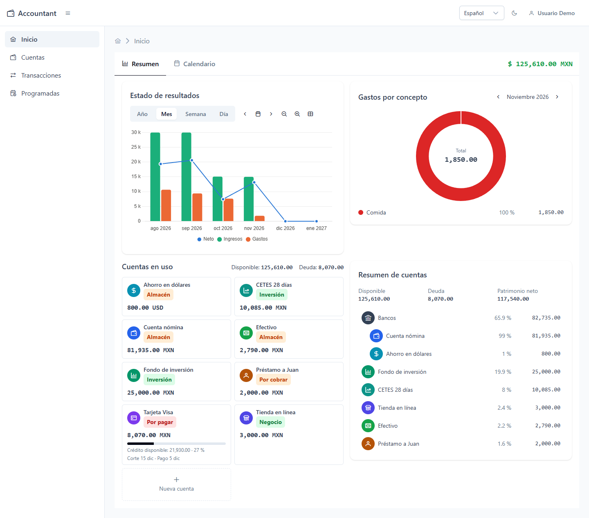

Este documento explica **cómo usar el sistema**. La instalación, el despliegue, la arquitectura y las reglas internas están en la [documentación técnica](docs/documentacion-tecnica.md).

---

## Contenido

1. [Qué puedes hacer](#1-qué-puedes-hacer)
2. [Primeros pasos](#2-primeros-pasos)
3. [Conceptos básicos](#3-conceptos-básicos)
4. [Tipos de cuenta](#4-tipos-de-cuenta)
5. [Tipos de transacción](#5-tipos-de-transacción)
6. [Cómo navegar por el sistema](#6-cómo-navegar-por-el-sistema)
7. [Tareas frecuentes](#7-tareas-frecuentes)
8. [Mensajes de error frecuentes](#8-mensajes-de-error-frecuentes)

---

## 1. Qué puedes hacer

- Llevar tus **cuentas** organizadas en grupos y sub-cuentas, con ícono, color y moneda.
- Registrar **tarjetas de crédito y préstamos** con su límite, fecha de corte y fecha límite de pago.
- Capturar **transacciones por lotes**: armas varias en un borrador, ves en vivo cómo quedan los saldos, revisas un resumen y guardas todo de una vez.
- Marcar movimientos como **pendientes** (dinero en tránsito, cargos por reflejarse) y **aplicarlos** cuando se reflejen.
- Definir **transacciones programadas** (renta, internet, nómina…) que el sistema te recuerda cuando vencen.
- Consultar el **Inicio**: estado de resultados, gastos por concepto, cuentas en uso, resumen de cuentas, calendario financiero y meta de ahorro anual.
- Usar la interfaz en **español o inglés** y en **modo claro u oscuro**.

Cada usuario solo ve sus propios datos. El primer usuario que se registra es el **administrador** (gestiona usuarios y monedas).

## 2. Primeros pasos

1. Abre el sistema en tu navegador. Con la instalación en Docker la dirección es `http://localhost:8085` (ver la [documentación técnica](docs/documentacion-tecnica.md#6-despliegue-con-docker)).
2. Si es la primera vez, entra a **Crear cuenta** y regístrate; después inicia sesión con tu usuario y contraseña.

   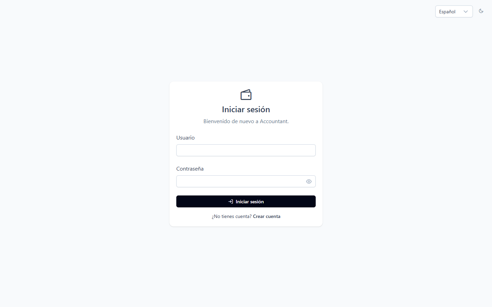

3. Crea tus cuentas. Un buen orden para empezar:
   1. **Grupos** opcionales para organizar ("Bancos", "Inversiones", "Gastos").
   2. Un **proveedor de ingresos** por cada fuente de ingreso (tu empleador, tus clientes).
   3. Un **almacén** por cada banco y uno para el efectivo, con su **saldo actual** como saldo inicial.
   4. Un **concepto de consumo** por cada tipo de gasto (Comida, Casa, Transporte, Servicios…).
   5. Una cuenta **por pagar** por cada tarjeta o préstamo, con su deuda actual y su línea de crédito.
   6. **Inversiones**, **negocios** y cuentas **por cobrar** si aplican.
4. A partir de ahí registra tus movimientos con **Transacciones → Nuevo lote**.

## 3. Conceptos básicos

| Concepto | Qué significa |
|---|---|
| **Cuenta** | Un lugar o concepto por donde pasa el dinero: tu banco, tu cartera, tu tarjeta, tu inversión, tu empleador o el concepto "Comida". |
| **Transacción** | Un movimiento de dinero de una cuenta **origen** a una cuenta **destino** (algunos tipos solo afectan al origen, como los intereses). |
| **Saldo** | El dinero de la cuenta. En una cuenta por pagar es lo que debes y en una por cobrar es lo que te deben. **Nunca puede ser negativo.** |
| **Monto** | La cantidad principal de la transacción (siempre mayor a 0). |
| **Comisión** | Cargo, retención o impuesto asociado a la transacción (puede ser 0; algunos tipos no la permiten). |
| **Tipo de operación** | Cómo cuenta la transacción en los reportes: **Ingreso**, **Gasto** o **Movimiento interno** (entre tus propias cuentas; de él solo cuenta la comisión como gasto). |
| **Pendiente** | Una parte del movimiento todavía no se refleja (por ejemplo, una transferencia en tránsito). No cambia ese saldo ni cuenta en reportes hasta que la **apliques**. |
| **Lote** | Grupo de transacciones que capturas juntas y se guardan todas o ninguna. |

Reglas que conviene tener presentes:

- **El gasto cuenta cuando consumes.** Una compra con tarjeta es gasto el día de la compra; pagar la tarjeta es un movimiento interno, así el gasto no se cuenta dos veces.
- **Las transacciones guardadas no se editan ni se borran.** El control está antes de guardar: en el editor de lotes y su resumen. Para corregir algo se registra otra transacción (o se ajusta el saldo de la cuenta, ver [Corregir un saldo](#corregir-un-saldo)).
- **No se reescribe el pasado.** La fecha de una transacción no puede ser anterior a la última transacción guardada de sus cuentas.
- **La moneda es ilustrativa.** Se muestra junto al saldo, pero no hay conversión entre monedas.

## 4. Tipos de cuenta

| Tipo | En pantalla | Qué representa | Ejemplos | ¿Tiene saldo? | Puede contener |
|---|---|---|---|---|---|
| `GROUP` | Grupo | Agrupador para organizar; nunca participa en transacciones. | "Bancos", "Familia" | No | Cualquier tipo |
| `SUPPLIER` | Proveedor de ingresos | De dónde viene tu dinero. | Empleador, cliente | No | Proveedores |
| `STORAGE` | Almacén | Donde guardas dinero disponible. | Cuenta bancaria, efectivo, monedero | Sí | Almacenes, inversiones, cuentas por pagar |
| `CONSUMER` | Consumo | Concepto de gasto. | Comida, casa, transporte | No | Conceptos de consumo |
| `BUSINESS` | Negocio | Negocio propio. | Tienda, freelance | Sí | Almacenes, inversiones |
| `INVESTMENT` | Inversión | Dinero invertido. | CETES, fondo, plazo fijo | Sí | Inversiones |
| `CREDITOR` | Por cobrar | Dinero que **tú prestaste**; el saldo es lo que te deben. | Préstamo a un amigo | Sí | Cuentas por cobrar |
| `DEBTOR` | Por pagar | Dinero que **tú debes**; el saldo es la deuda. Puede tener línea de crédito. | Tarjeta de crédito, préstamo personal | Sí | Cuentas por pagar |

Opciones y reglas de las cuentas:

- **Cuenta padre:** puedes colgar una cuenta de otra para formar grupos y sub-cuentas. Solo se ofrecen como padre las cuentas que aceptan ese tipo (columna "Puede contener") y que no son sub-cuentas de la misma cuenta, para evitar ciclos.
- **Nombre:** no puede repetirse entre cuentas del mismo tipo.
- **Cambio de tipo:** libre mientras la cuenta no tenga sub-cuentas ni transacciones. Si ya las tiene, solo puede cambiar entre Almacén e Inversión. Una cuenta con línea de crédito debe seguir siendo Por pagar.
- **Saldo editable:** puedes corregir el saldo desde el formulario. El cambio se aplica directamente y **no genera transacción** (sirve para el saldo inicial o para ajustes).
- **Incluir en el balance:** decide si la cuenta suma en "Cuentas en uso" y en los totales del Inicio.
- **Estados:** **Activa**, **Deshabilitada** (no se puede usar en transacciones; se puede reactivar) y **Eliminada**. Solo se puede eliminar una cuenta con saldo 0 y sin sub-cuentas.
- **Cuenta temporal** (solo Inversión y Negocio): cuando se aplica un **Retiro de inversión** que sale de ella, la cuenta se deshabilita sola (la inversión terminó), aunque le quede saldo. Puedes reactivarla después.

### Línea de crédito (cuentas por pagar)

Una cuenta Por pagar puede tener **línea de crédito**:

- **Límite de crédito:** ninguna compra, disposición o interés puede hacer que la deuda lo supere.
- **Fecha de corte** y **fecha límite de pago:** se eligen como "día N de cada mes", "último día del mes" o una expresión avanzada; el formulario muestra las próximas 3 fechas.
- El sistema mantiene la próxima fecha de corte y de pago al día, y muestra el **crédito disponible** y el **porcentaje de uso**.

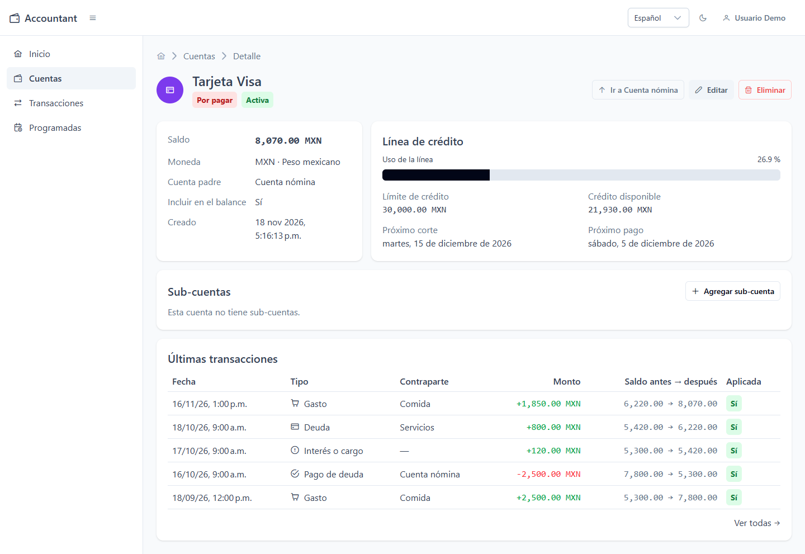

## 5. Tipos de transacción

Notación: **A** = monto, **C** = comisión.

### Qué cuentas usa cada tipo

| Tipo | En pantalla | Para qué sirve | Origen | Destino |
|---|---|---|---|---|
| `INCOME` | Ingreso | Sueldo, cobro a un cliente | Proveedor de ingresos | Almacén |
| `EXPENSE` | Gasto | Consumo con dinero propio o con tarjeta | Almacén o Por pagar | Consumo |
| `TRANSFER` | Transferencia | Mover dinero entre tus almacenes | Almacén | Almacén |
| `INVEST` | Inversión | Meter dinero a una inversión o negocio | Almacén o Inversión | Inversión o Negocio |
| `PROFIT` | Retiro de inversión | Sacar los recursos de una inversión o negocio | Inversión o Negocio | Almacén o Inversión |
| `DIVIDEND` | Rendimiento | Lo que te paga una inversión | Inversión, Negocio, Almacén o Por cobrar | Opcional, de los mismos tipos |
| `INTEREST` | Interés o cargo | Interés, comisión o cargo en tu contra | Inversión, Negocio, Almacén o Por pagar | Ninguno |
| `BORROW` | Préstamo otorgado | Prestarle dinero a alguien | Almacén | Por cobrar |
| `COLLECTION` | Cobro de préstamo | Cobrar un préstamo que hiciste | Por cobrar | Almacén |
| `DEBT` | Deuda | Préstamo en efectivo o compra a crédito | Por pagar | Almacén o Consumo |
| `PAYMENT` | Pago de deuda | Pagar una tarjeta o préstamo | Almacén | Por pagar |

El origen y el destino siempre deben ser cuentas distintas y activas. Los selectores del formulario solo muestran las cuentas válidas para el tipo elegido.

### Cómo cambian los saldos

| Tipo | Qué se valida | Origen | Destino |
|---|---|---|---|
| Ingreso | La comisión es menor que el monto | — | `+ (A − C)` |
| Gasto desde Almacén | Hay fondos para `A + C` | `− (A + C)` | — |
| Gasto desde Por pagar | No se rebasa el límite de crédito | La deuda crece `A + C` | — |
| Transferencia, Inversión, Retiro de inversión | Hay fondos para `A`; la comisión es menor que el monto | `− A` | `+ (A − C)` |
| Rendimiento | La comisión es menor que el monto | Sin destino: `+ (A − C)` | Con destino: `+ (A − C)` |
| Interés (no Por pagar) | Hay fondos; sin comisión | `− A` | — |
| Interés sobre Por pagar | No se rebasa el límite; sin comisión | La deuda crece `A` | — |
| Préstamo otorgado | Hay fondos; sin comisión | `− A` | `+ A` |
| Cobro de préstamo | No se cobra más de lo que te deben; sin comisión | `− A` | `+ A` |
| Deuda → Almacén | No se rebasa el límite; la comisión es menor que el monto | La deuda crece `A` | `+ (A − C)` |
| Deuda → Consumo | No se rebasa el límite; sin comisión | La deuda crece `A` | — |
| Pago de deuda | Hay fondos para `A + C`; no se paga más de lo que se debe | `− (A + C)` | La deuda baja `A` |

### Movimientos pendientes

Por defecto todo se aplica al guardar. Solo estos tipos pueden quedar **pendientes**:

| Tipo | Qué queda pendiente | Qué se aplica de inmediato |
|---|---|---|
| Gasto | El cargo a la cuenta origen | — |
| Transferencia, Inversión, Retiro de inversión | El abono a la cuenta destino | El cargo a la cuenta origen |

Ejemplo: pides hoy un retiro de una inversión que llega mañana. Lo registras como Retiro de inversión **pendiente**: el origen se descuenta en ese momento y el destino no cambia. Cuando el dinero llegue, usa **Aplicar** y se suma en el destino. Al aplicar se vuelven a validar los fondos o el límite de crédito.

### Cómo cuenta en los reportes

| Tipo de operación | Tipos | Qué cuenta |
|---|---|---|
| **Ingreso** | Ingreso, Rendimiento | `A − C` como ingreso |
| **Gasto** | Gasto (de Almacén o con tarjeta), Interés, Deuda → Consumo | `A + C` como gasto |
| **Movimiento interno** | Transferencia, Inversión, Retiro de inversión, Préstamo otorgado, Cobro de préstamo, Deuda → Almacén, Pago de deuda | Solo `C`, como gasto en el concepto "Comisiones" |

Los reportes usan la **fecha en que el movimiento se aplicó**; lo pendiente no cuenta todavía. Algunos ejemplos:

| Escenario | Transacciones | Ingreso | Gasto | Neto |
|---|---|---|---|---|
| Compra con tarjeta y su pago | Gasto Visa → Comida 10,000, luego Pago de deuda 10,000 | 0 | 10,000 | −10,000 |
| Préstamo en efectivo usado y pagado | Deuda → Banco 10,000, Gasto 10,000, Pago de deuda 10,000 | 0 | 10,000 | −10,000 |
| Préstamo en efectivo devuelto sin usar | Deuda → Banco 10,000, Pago de deuda 10,000 | 0 | 0 | 0 |
| Interés de la tarjeta y su pago | Interés Visa 500, Pago de deuda 500 | 0 | 500 | −500 |
| Pago con comisión | Pago de deuda 10,000 con comisión 50 | 0 | 50 | −50 |

### ¿Qué tipo uso?

| Quiero registrar… | Tipo | Origen → Destino |
|---|---|---|
| Me pagaron la quincena | Ingreso | Empleador → Banco |
| Pagué el súper con débito | Gasto | Banco → Comida |
| Pagué el súper con tarjeta de crédito | Gasto (o Deuda) | Visa → Comida |
| Pagué la tarjeta | Pago de deuda | Banco → Visa |
| Retiré efectivo del cajero | Transferencia | Banco → Efectivo |
| Metí dinero a CETES | Inversión | Banco → CETES |
| Me dieron rendimientos | Rendimiento | CETES (→ Banco, opcional) |
| Retiré mi inversión | Retiro de inversión | CETES → Banco |
| Me cobraron una comisión bancaria | Interés o cargo | Banco |
| Le presté a un amigo / me pagó | Préstamo otorgado / Cobro de préstamo | Banco → Préstamo a Juan / Préstamo a Juan → Banco |
| Saqué un préstamo personal | Deuda | Préstamo → Banco |

## 6. Cómo navegar por el sistema

### Barra superior y menú

- **Accountant** (a la izquierda) te lleva al Inicio. El botón **☰** junto al nombre muestra u oculta el menú lateral; en pantallas chicas abre el menú deslizable.
- A la derecha están el **idioma** (Español / English), el botón de **modo claro / oscuro** y tu **usuario** (cerrar sesión).
- El **menú lateral** lleva a Inicio, Cuentas, Transacciones y Programadas; los administradores ven además **Usuarios** y **Monedas**.
- Debajo de la barra está la **ruta** de la pantalla actual (por ejemplo, Cuentas › Detalle › Editar).

### Inicio

El Inicio tiene dos pestañas. A la derecha de las pestañas se muestra tu **saldo disponible** (la suma de tus cuentas con saldo, sin contar deudas).

**Resumen**

- **Estado de resultados:** barras de ingresos y gastos y línea del neto por año, mes, semana o día. Con los botones puedes moverte entre periodos, volver a hoy, ampliar o reducir cuántos periodos ves y cambiar a vista de tabla.
- **Gastos por concepto:** dona con los gastos del mes elegido, agrupados por concepto de consumo (y "Comisiones"), con el color de cada cuenta.
- **Cuentas en uso:** tarjetas de las cuentas activas con saldo e incluidas en el balance, con el total disponible y la deuda. Las tarjetas de crédito muestran su uso, el crédito disponible y sus fechas de corte y pago. Al hacer clic se abre el detalle de la cuenta.
- **Resumen de cuentas:** tus cuentas agrupadas con su total y el porcentaje que representan; muestra aparte el disponible, la deuda y el patrimonio neto.

**Calendario**

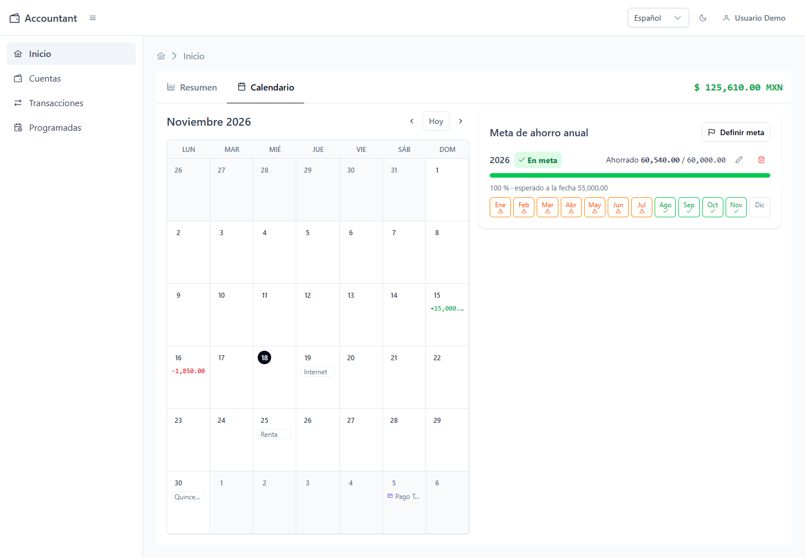

- **Calendario del mes** (la semana empieza en lunes): ingresos en verde y gastos en rojo por día, fechas de corte y pago de tus tarjetas y las próximas transacciones programadas (con borde punteado). Al hacer clic en un día se abre el detalle: transacciones aplicadas ese día, eventos de tarjetas y programadas.
- **Meta de ahorro anual:** cuánto quieres ahorrar (neto) en el año y cómo vas. Muestra las metas que has registrado (las 3 más recientes), con una barra de avance, el estado del año y el estado de cada mes. Se define o edita con **Definir meta** o con el lápiz; la meta del año actual se puede eliminar, la de un año que ya terminó no.

Las capturas de esta guía están en modo claro; el sistema también tiene **modo oscuro**, que se activa con el botón de la luna en la barra superior (la preferencia se guarda en el navegador):

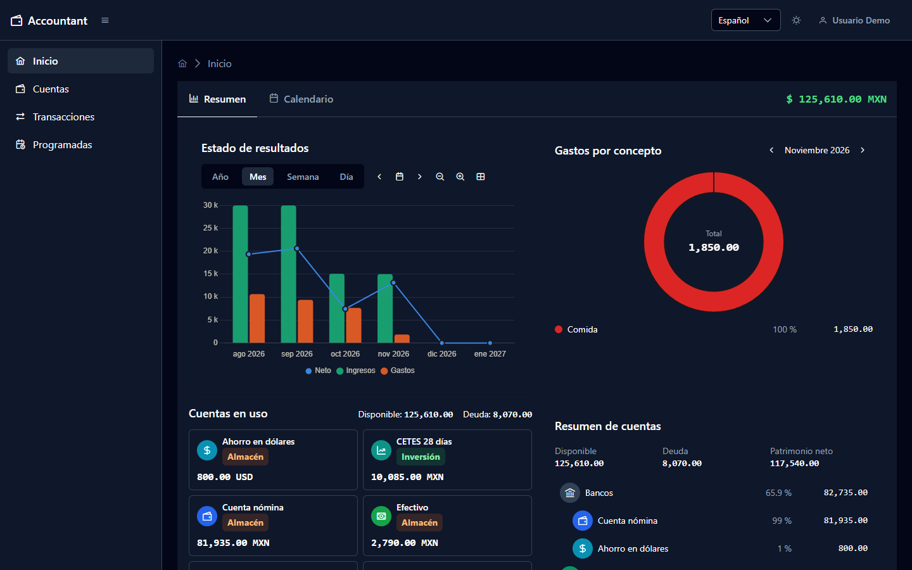

### Cuentas

**Listado:** filtra por nombre, tipo y estado, ordena por columna y pagina. Los filtros se guardan en la dirección de la página, así que puedes recargar o compartir la vista. **Nueva cuenta** abre el formulario.

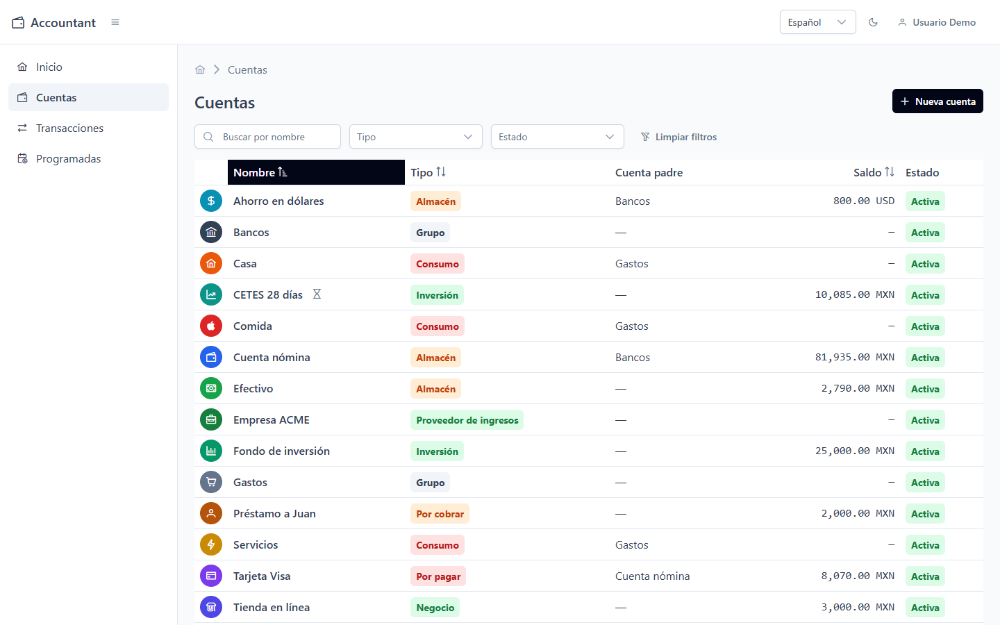

**Detalle:** datos de la cuenta, línea de crédito (si tiene), sub-cuentas y últimas transacciones.

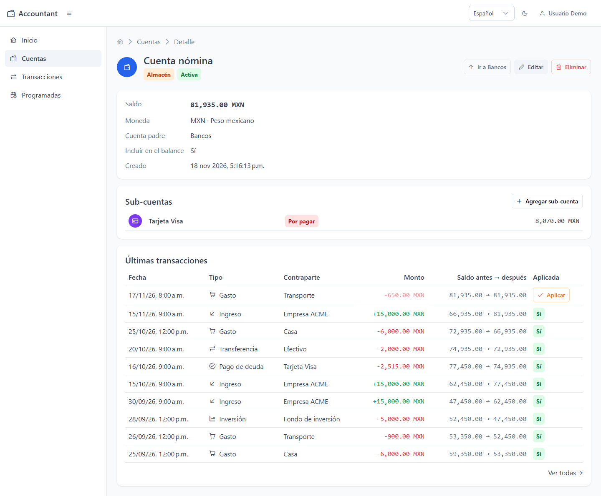

- **Ir a [cuenta padre]** te lleva a la cuenta de la que cuelga; **Editar** y **Eliminar** están junto a él (al eliminar regresas a la cuenta padre, o al listado si no tiene).
- **Sub-cuentas:** primero las cuentas por pagar, luego las por cobrar y después las demás. Todo el renglón abre la sub-cuenta y las deshabilitadas se marcan en rojo. **Agregar sub-cuenta** abre "Nueva cuenta" con esta cuenta ya elegida como padre.
- **Últimas transacciones:** las 10 más recientes con el efecto en esta cuenta y su saldo antes → después. Las pendientes tienen el botón **Aplicar**. **Ver todas** abre el listado de transacciones filtrado por esta cuenta.

**Formulario (nueva / editar):** nombre, tipo, cuenta padre, moneda, estado, saldo, ícono, color (selector o código hexadecimal), incluir en el balance, cuenta temporal y, para cuentas por pagar, la línea de crédito.

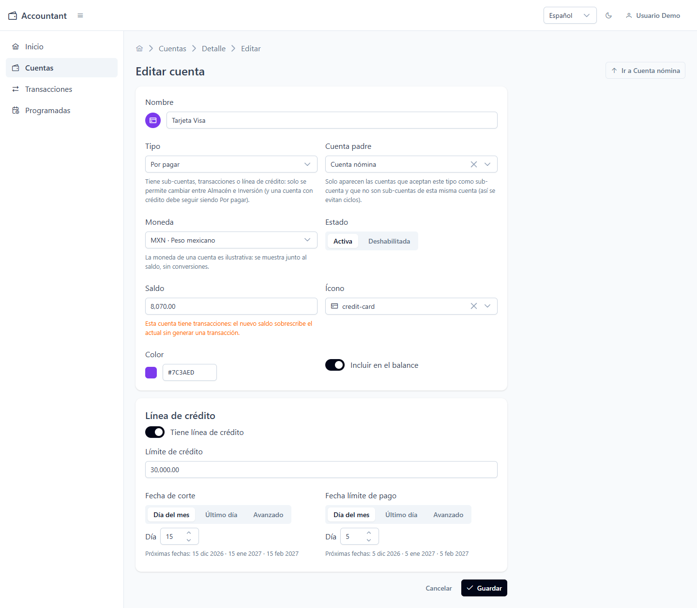

### Transacciones

**Listado:** todas tus transacciones guardadas, con filtros por descripción, tipo, cuenta, estado (aplicadas / pendientes) y fechas. Las pendientes tienen el botón **Aplicar**. **Nuevo lote** abre el editor.

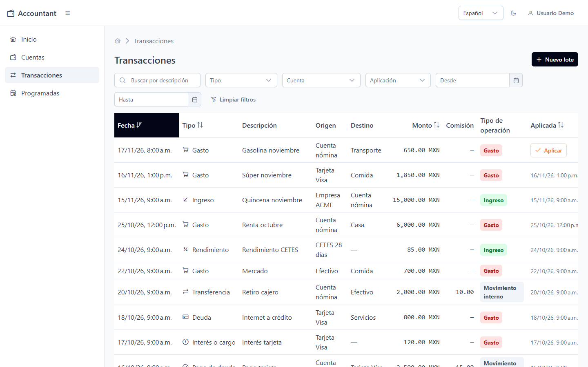

**Nuevo lote (editor):**

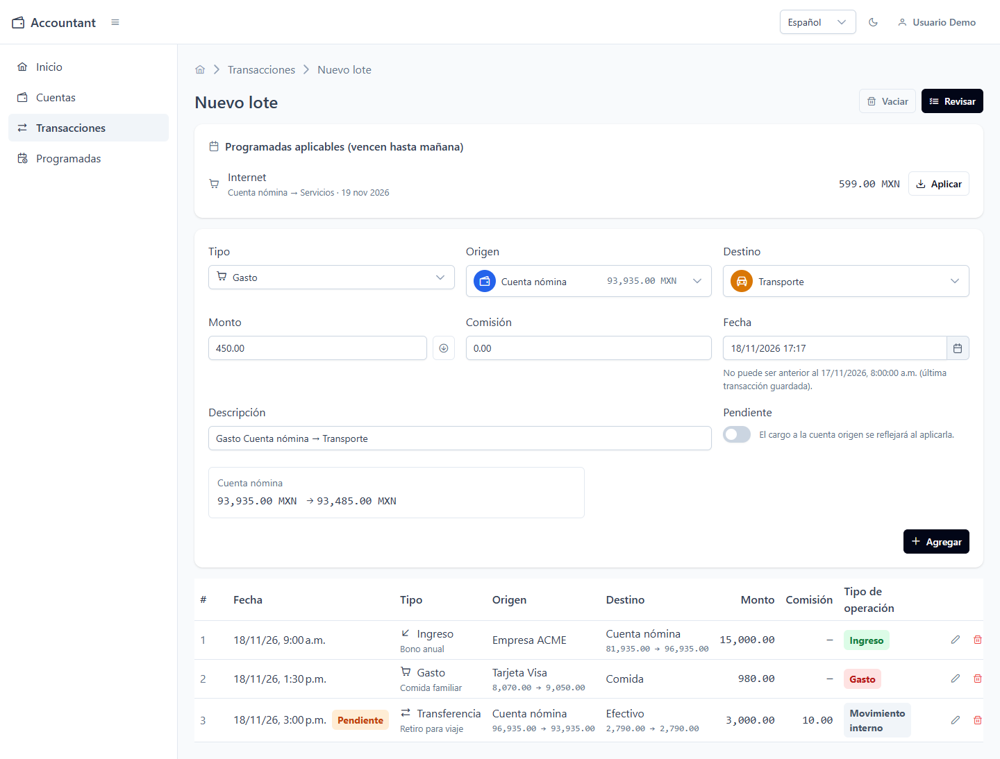

- **Programadas aplicables:** las programadas que vencen hoy o mañana. **Aplicar** llena el formulario con sus datos (el tipo y las cuentas quedan fijos).
- **Formulario:** tipo, origen, destino, monto, comisión, fecha, descripción y "Pendiente" (solo en los tipos que lo permiten). La descripción se genera sola hasta que la escribes tú. El botón junto al monto copia el saldo disponible del origen.
- **Vista previa:** debajo del formulario ves el saldo de cada cuenta antes → después de la transacción (y el crédito disponible en tarjetas). Si algo no es válido se muestra el motivo.
- **Agregar** suma la transacción al lote y limpia el formulario para la siguiente.
- **Tabla del lote:** las transacciones en orden de fecha con sus saldos antes → después y su tipo de operación. Puedes editarlas o eliminarlas; todo el lote se recalcula.
- El borrador se guarda en tu navegador: si recargas la página no se pierde. Si mientras tanto cambió el saldo de alguna cuenta, el sistema te avisa y recalcula.
- **Vaciar** descarta el borrador.

**Revisar:** abre el resumen del lote antes de guardar: ingresos, gastos y neto, número de transacciones y pendientes, avisos (cuentas temporales que se deshabilitarán, pendientes) y cada cuenta afectada con su saldo actual → proyectado. **Guardar lote** guarda todo de una vez; si algo falla no se guarda nada y se indica qué transacción falló.

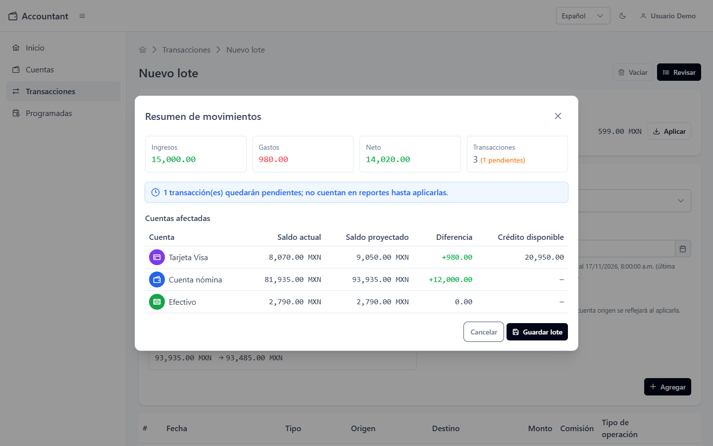

### Programadas

**Listado:** tus transacciones recurrentes con su recurrencia, próxima ejecución y estado. Desde cada renglón puedes **editar**, **saltar** la próxima ejecución, **activar / desactivar** o **eliminar**.

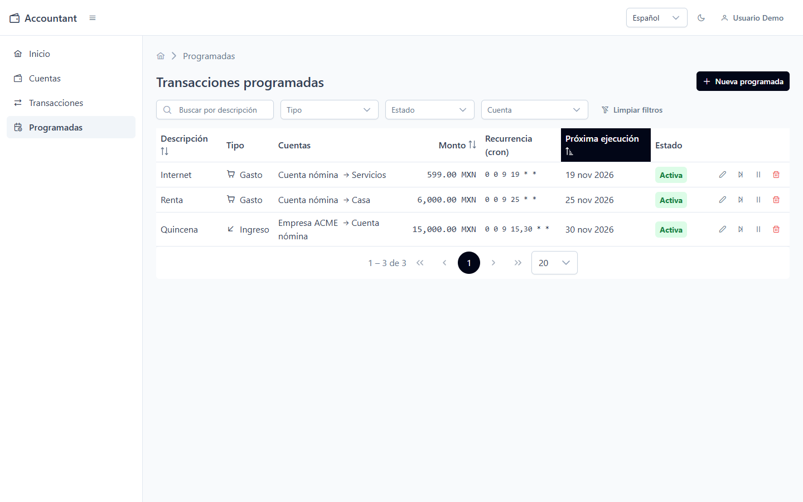

**Formulario:** tipo, cuentas, monto, comisión y descripción (con las mismas reglas que una transacción), la **recurrencia** ("día del mes", "último día" o avanzada, con las próximas fechas) y, opcionalmente, la próxima ejecución.

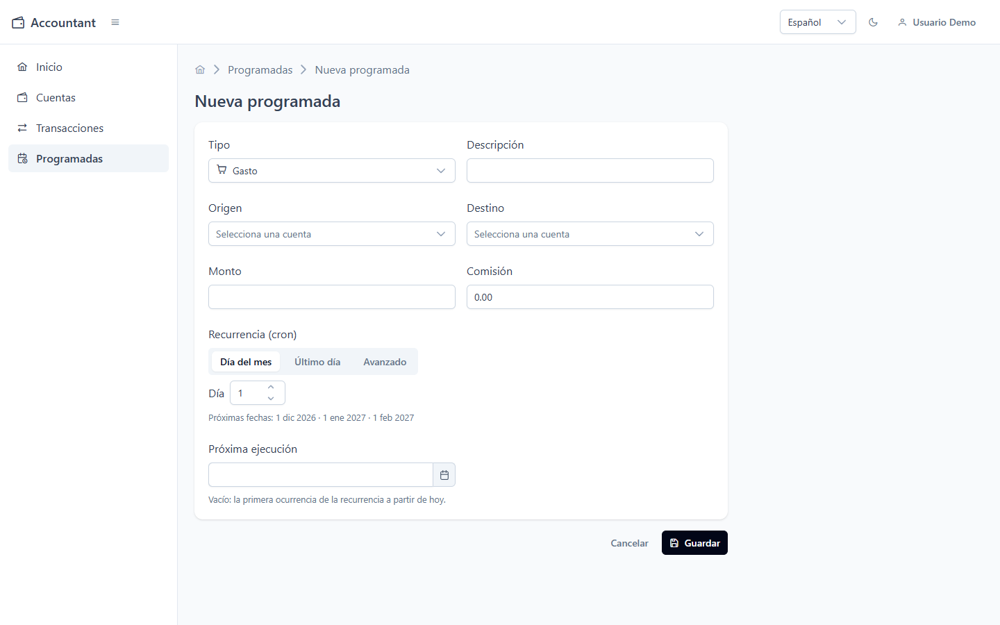

### Administración (solo administrador)

- **Usuarios:** listado de usuarios con filtros; permite cambiar el nombre y habilitar o deshabilitar usuarios. Solo puede haber un administrador.
- **Monedas:** catálogo de monedas disponibles para las cuentas (agregar, editar, habilitar o deshabilitar).

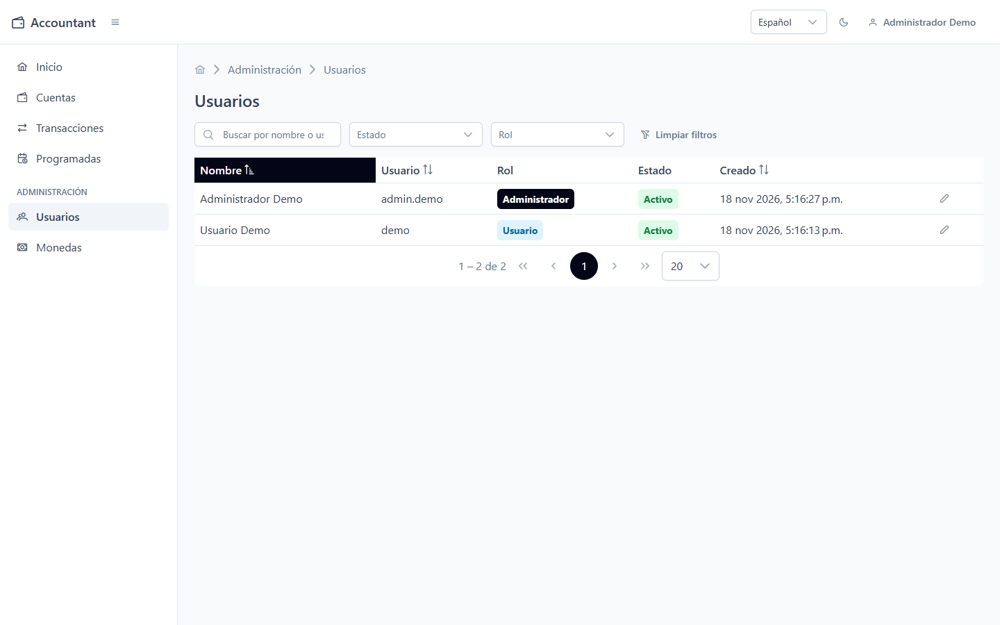

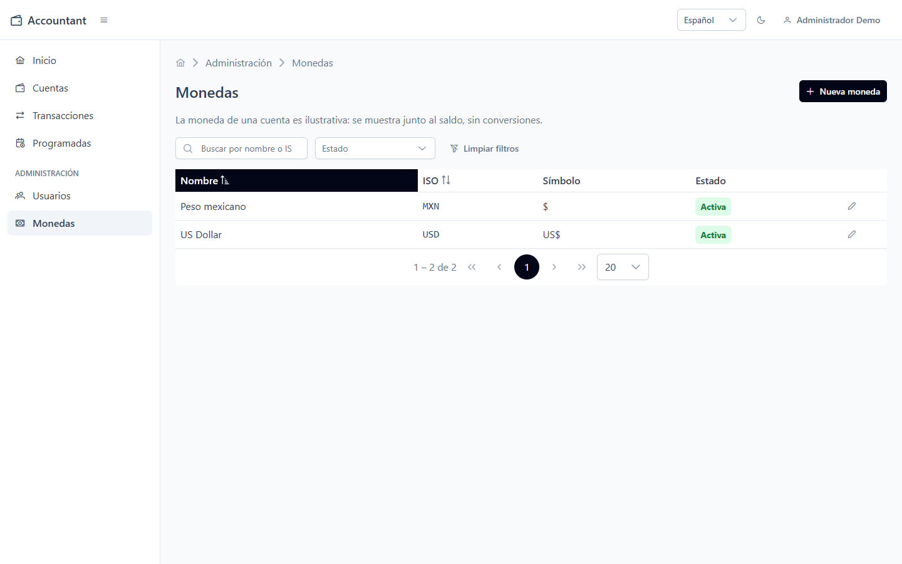

## 7. Tareas frecuentes

### Agregar una cuenta

1. **Cuentas → Nueva cuenta** (o la tarjeta "Nueva cuenta" del Inicio, o **Agregar sub-cuenta** desde el detalle de su cuenta padre).
2. Captura el **nombre** y el **tipo**; elige la **cuenta padre** si va dentro de otra.
3. Elige **moneda**, **ícono** y **color**.
4. Si el tipo tiene saldo, captura el **saldo inicial**.
5. Marca **Incluir en el balance** si debe sumar en el Inicio, y **Cuenta temporal** si es una inversión o negocio que se cerrará con su retiro.
6. Si es una tarjeta o préstamo, activa **Tiene línea de crédito** y captura el límite, el día de corte y el día de pago.
7. **Guardar.**

### Registrar movimientos

1. **Transacciones → Nuevo lote.**
2. Para cada movimiento: elige el tipo, las cuentas, el monto (y la comisión si aplica) y la fecha; revisa la vista previa y presiona **Agregar**.
3. Si una programada está por vencer, usa **Aplicar** en el panel de programadas aplicables.
4. Presiona **Revisar**, verifica los totales y las cuentas afectadas, y **Guardar lote**.

### Aplicar un movimiento pendiente

Cuando el movimiento se refleje en tu banco, presiona **Aplicar** en el listado de transacciones (filtra por "Pendientes") o en "Últimas transacciones" del detalle de la cuenta.

### Programar un pago recurrente

1. **Programadas → Nueva programada.**
2. Captura tipo, cuentas, monto y descripción, y elige la recurrencia (por ejemplo, "día 5 de cada mes").
3. **Guardar.** Cuando venza aparecerá en el panel de programadas aplicables del editor de lotes y en el calendario.

### Definir la meta de ahorro

En **Inicio → Calendario**, presiona **Definir meta** y captura cuánto quieres ahorrar en el año (ingresos menos gastos). La meta mensual es una doceava parte; cada mes se marca en verde si la alcanzó, en naranja si quedó por debajo y en rojo si el neto fue negativo.

### Corregir un saldo

Si el saldo de una cuenta no coincide con el real, edita la cuenta y cambia el **Saldo**. El ajuste se aplica directamente, sin generar transacción.

## 8. Mensajes de error frecuentes

| Mensaje | Qué pasó |
|---|---|
| Fondos insuficientes | La cuenta origen no tiene saldo para el movimiento. |
| Se excede el límite de crédito | La deuda de la tarjeta superaría su límite. |
| El monto excede el saldo | Intentas pagar más de lo que debes o cobrar más de lo que te deben. |
| La fecha es anterior a la última transacción guardada | Las cuentas ya tienen movimientos posteriores; usa una fecha igual o posterior. |
| La cuenta está deshabilitada | La cuenta no está activa (por ejemplo, una inversión temporal ya cerrada). Reactívala desde su formulario. |
| No se puede eliminar la cuenta | Tiene saldo distinto de 0 o sub-cuentas. |
| Los datos cambiaron mientras se guardaban | Otra operación modificó alguna cuenta del lote; el editor recalcula con los saldos nuevos para que revises y guardes de nuevo. |
